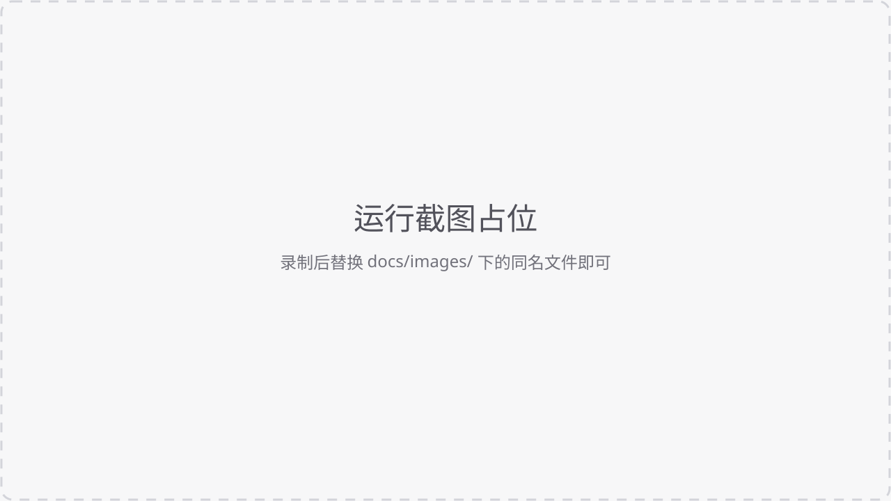
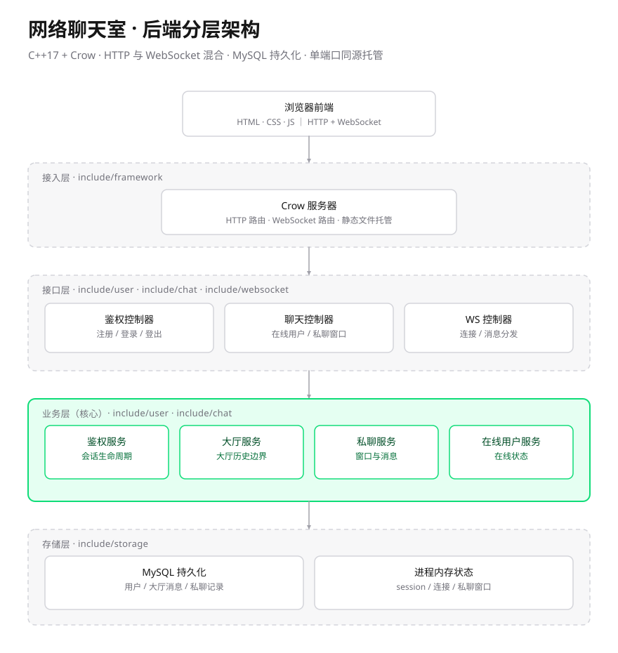

# 网络聊天室

基于 **C++17 + Crow + WebSocket + MySQL** 的模块化网络聊天室。

一个 Crow 进程同时承担三件事：HTTP 业务接口、WebSocket 实时通信、前端静态页面托管。页面和接口天然同源，只需暴露一个端口；对外部署时由 Nginx 终止 TLS 并反向代理。业务数据（用户、大厅消息、私聊会话与消息）持久化在 MySQL，登录态与在线状态保存在进程内存。

仓库内的前端统一为 `chatroom-app/`：基于 uni-app（Vue 3 + TypeScript），一套代码同时构建 **Web** 与 **微信小程序**。Web 端构建产物同步到 `frontend/` 后由后端直接托管，因此 <http://localhost:8080> 与开发服务器 <http://localhost:5173> 是同一套界面与同一份在线逻辑。



## 界面预览

> 当前是占位图。录制自己的运行效果后，把文件放进 `docs/images/` 并替换下面对应路径即可。

<!-- GIF 演示位：建议 10~20 秒，覆盖 登录 → 进入大厅 → 发送消息 → 私聊 -->
<!-- 替换为： -->

| 聊天大厅 | 在线用户 | 私聊窗口 |
| --- | --- | --- |
|  |  |  |

建议文件名：`login.png`、`chat.png`、`online-users.png`、`private-chat.png`、`demo.gif`。

> 多端前端（`chatroom-app/`）的实际界面截图已放在 `chatroom-app/.screenshots/`，包含桌面、平板与手机三种尺寸。

## 功能

### 已实现

- **昵称账号体系**：昵称唯一，注册 / 登录 / 登出，登录成功返回 `sessionId`
- **混合通信**：HTTP 负责注册、登录、登出、在线列表、创建私聊；WebSocket 负责大厅消息、私聊消息、历史拉取、在线状态推送
- **大厅聊天**：进入大厅后可发言，历史只显示「本次进入大厅之后」的消息
- **在线用户**：实时列表与变更推送，点击用户即可发起私聊
- **私聊**：创建私聊窗口、双向收发、历史拉取；退出登录时清理该用户相关的私聊窗口
- **会话生命周期**：已连接的会话断线后保留 5 分钟重连宽限；登录后 15 秒内未建立 WebSocket 则失效；服务端每 15 秒回收一次并同步清理私聊；同一昵称在线时拒绝重复登录
- **持久化**：用户、大厅消息、私聊窗口与私聊消息写入 MySQL，首次启动自动建表
- **单端口部署**：后端直接托管 `frontend/`，无需额外静态服务器，也不需要 CORS
- **前端交互**：断线自动重连（指数退避）、未读徽章、多标签页会话同步、离开页面静默断开
- **多端前端**：`chatroom-app/` 用 uni-app + Vue 3 重写了界面，同一份代码构建 Web 与微信小程序，桌面 / 平板 / 手机响应式适配，交互流程与接口协议和上面完全一致

### 尚未实现 / 已知限制

- **密码是明文存储和明文比对**（`auth_service_impl.cpp`），公网部署前应改为哈希（如 bcrypt/argon2）
- **单实例**：登录态、在线状态、WebSocket 连接都在进程内存，无法多实例横向扩展
- **无内置 TLS**：HTTP 与 WebSocket 本身不加密，需要 Nginx 等反向代理补上
- **端口写死**：`kServerPort = 8080`、`kBindAddress = 127.0.0.1` 是编译期常量，暂不支持环境变量配置
- **不支持富媒体**：只能发文本，没有图片 / 文件 / 语音消息
- **无消息治理**：没有撤回、删除、已读回执、编辑
- **无社交关系**：没有好友列表、黑名单、群聊，私聊对象必须是当前在线用户
- **无管理能力**：没有管理员后台、封禁、限流、防刷
- **仅 Windows 实测**：CMake 里有 Linux 分支（`pkg-config mysqlclient`），但未在 Linux 上验证过

## 技术栈

| 层次 | 选型 |
| --- | --- |
| 语言 | C++17 |
| Web 框架 | Crow（`crow_all.h`，随仓库提供） |
| 网络库 | Boost.Asio（Boost 1.78 头文件） |
| 实时通信 | WebSocket（`/ws/chat`） |
| 数据存储 | MySQL 8.0（官方 C API） |
| 前端 | uni-app（Vue 3 + TypeScript + Vite），产出 Web 与微信小程序；Web 构建产物由后端托管 |
| 构建 | CMake + Visual Studio 2022 |
| 测试 | CTest + Node.js 集成脚本 |

## 架构



请求链路：`浏览器 / 微信小程序 ──HTTP / WebSocket──▶ Crow 进程 :8080 ──▶ MySQL`。Web 构建产物 `frontend/` 由同一个 Crow 进程托管，session、在线状态与 WebSocket 连接保存在进程内存；`chatroom-app/` 构建出的小程序端复用同一套接口。

> 图为 `docs/images/architecture.svg`，可直接编辑该文件调整配色或模块名。

| 通道 | 路径 | 用途 |
| --- | --- | --- |
| HTTP POST | `/api/v1/auth/register` | 注册 |
| HTTP POST | `/api/v1/auth/login` | 登录，返回 `sessionId` |
| HTTP POST | `/api/v1/auth/logout` | 登出 |
| HTTP GET | `/api/v1/users/online` | 在线用户列表 |
| HTTP POST | `/api/v1/private-chat/session` | 创建私聊窗口 |
| HTTP GET | `/api/v1/health` | 健康检查（含数据库连通性） |
| WebSocket | `/ws/chat?sessionId=...` | 大厅 / 私聊消息与历史 |
| HTTP GET | `/`、`/<path>` | 前端页面与静态资源 |

HTTP 鉴权走请求头 `X-Session-Id`，WebSocket 走握手参数 `sessionId`。

WebSocket 事件：`lobby.enter`、`lobby.message.send`、`lobby.message.receive`、`lobby.history.pull`、`lobby.history.response`、`private.message.send`、`private.message.receive`、`private.history.pull`、`private.history.response`、`online.users.changed`、`chat.error`。

## 目录结构

```
chatroom/
├─ src/main.cpp                 程序入口：依赖装配、路由注册、启动
├─ include/
│  ├─ framework/                Crow 启动装配、路由注册、统一响应格式
│  ├─ models/                   用户、消息、大厅会话、私聊会话模型
│  ├─ user/                     注册、登录、登出、鉴权
│  ├─ chat/                     大厅、私聊、在线用户、聊天协议
│  ├─ websocket/                连接管理、消息分发、连接生命周期
│  ├─ storage/                  存储接口；mysql/ 下为 MySQL 实现
│  └─ common/                   公共常量与随机 ID
├─ frontend/                    多端前端的 Web 构建产物（由后端直接托管）
├─ chatroom-app/                多端前端（uni-app + Vue 3 + TypeScript，Web + 微信小程序）
├─ tests/                       会话生命周期测试 + WebSocket 集成测试
├─ docs/images/                 README 截图与架构图
├─ crow_all.h                   内置的 Crow 头文件
├─ third_party/boost_1_78_0/    Boost 头文件（未入库，需自行放置）
├─ CMakeLists.txt
├─ build.ps1                    一键构建
├─ start-backend.ps1            一键启动（读取 .env）
├─ .env.example                 配置模板
└─ README.md
```

## 快速开始

整个流程只有两件事：**初始化**（只做一次）和**启动**（每次都用）。

| 场景 | 要执行的命令 | 说明 |
| --- | --- | --- |
| 第一次拿到项目 | `./build.ps1` | 把源码编译成 exe，**不启动服务** |
| 每次要用 | `./start-backend.ps1` | 启动服务，然后浏览器访问 |
| 改了代码 | `./build.ps1` → 停掉旧进程 → `./start-backend.ps1` | 增量编译通常很快 |

所以最省事的路径是：**装 MySQL + 建库账号**（第 0、1 步）→ **`./build.ps1`**（第 3 步，只做一次）→ **`./start-backend.ps1`**（第 4 步）。数据库密码在启动时输入即可，`.env` 是可选的（第 2 步），只用来省掉每次输入。

### 最短路径：已有 MySQL 的话，3 条命令跑起来

1. 用资源管理器打开项目文件夹，**在顶部地址栏输入 `pwsh` 回车**（窗口会直接定位到项目目录）
2. 执行 `./build.ps1` —— 第一次编译，等它跑完
3. 执行 `./start-backend.ps1` —— 按提示输入数据库密码
4. 浏览器打开 <http://localhost:8080/>

下面「先认识 PowerShell」一节解释这几条命令在干什么，遇到报错可以对照后面的常见问题。

### 环境依赖

| 依赖 | 版本 | 说明 |
| --- | --- | --- |
| Windows | 10 / 11 x64 | 当前唯一验证过的平台 |
| Visual Studio 2022 | 含「使用 C++ 的桌面开发」 | 提供 MSVC 与 Windows SDK |
| CMake | ≥ 3.16 | 需要加入 PATH |
| MySQL Server 8.0 | 开发时用 8.0.45 | 需要 `include/mysql.h`、`lib/libmysql.lib`、`libmysql.dll`、`libssl-3-x64.dll`、`libcrypto-3-x64.dll` |
| Boost | 1.78 | 解压到 `third_party/boost_1_78_0`，该目录不入库 |
| Crow | — | 仓库根目录的 `crow_all.h` 已内置，无需额外安装 |
| Node.js | 可选 | 仅用于 WebSocket 集成测试 |

Boost 1.78 下载地址：<https://archives.boost.io/release/1.78.0/source/boost_1_78_0.zip>，解压后目录结构应为 `third_party/boost_1_78_0/boost/version.hpp`。

MySQL 默认安装在 `C:/Program Files/MySQL/MySQL Server 8.0`；装在别处时，配置时加 `-DMYSQL_ROOT_DIR="你的安装目录"`。

### 先认识 PowerShell（新手必读，老手跳过）

> **已经用过 PowerShell、平时在终端里敲命令的人，这一整节可以直接跳过**，从第 0 步开始。
>
> 只有遇到下面任意一种情况才需要展开：
> - 不确定自己打开的是 cmd 还是 PowerShell
> - 执行 `./build.ps1` 报“不是内部或外部命令”
> - 报错“无法加载文件……因为在此系统上禁止运行脚本”

这一节讲的是**在 Windows 上怎么运行 `.ps1` 脚本**这件通用的事，和聊天室功能无关，只解决三个问题：用哪个窗口、怎么执行、被系统拦住怎么办。

<details>
<summary><b>展开查看：PowerShell 使用说明</b></summary>

**① 用哪个窗口**

看提示符即可判断：

| 窗口 | 提示符 | 能否执行本项目脚本 |
| --- | --- | --- |
| PowerShell | `PS C:\Users\31586\Desktop\网络聊天室\chatroom>` | ✅ |
| cmd | `C:\Users\31586\Desktop\网络聊天室\chatroom>` | ❌ 会报“不是内部或外部命令” |

**② 怎么打开 PowerShell（任选一种）**

1. **最快**：在资源管理器里打开项目文件夹，点一下窗口顶部的地址栏（显示路径的那一栏），输入 `pwsh` 回车。窗口会直接定位在项目目录，不用再 `cd`。
   - 提示找不到 `pwsh`，就输入 `powershell`，打开系统自带的 Windows PowerShell（同样能用）。
2. 开始菜单搜索 `PowerShell 7`（或 `PowerShell`）打开，再切换目录：

   ```powershell
   cd "C:\Users\31586\Desktop\网络聊天室\chatroom"
   ```

3. 在 VS Code 里按 <kbd>Ctrl</kbd> + <kbd>`</kbd> 打开终端，默认就是 PowerShell。

**③ 怎么执行脚本（通用写法，真正的命令在第 3、4 步）**

在 PowerShell 里运行脚本的写法就是 `./脚本名.ps1`，回车即执行。本项目的两条实际命令分别是第 3 步的 `./build.ps1` 和第 4 步的 `./start-backend.ps1`；这里只说明通用规则：

- 粘贴后要按 **回车** 才执行；<kbd>Ctrl</kbd> + <kbd>V</kbd> 或鼠标右键都能粘贴。
- `./build.ps1` 和 `.\build.ps1` 等价，两种写法都行（Windows PowerShell 里用反斜杠更稳）。
- 脚本跑起来后窗口会被日志占住，这是正常的，不是卡死；**<kbd>Ctrl</kbd> + <kbd>C</kbd> 停止**。
- 关掉窗口 = 程序停止。想让它一直跑，就别关这个窗口。

**④ 被系统拦住了怎么办**

提示“无法加载文件 … 因为在此系统上禁止运行脚本”属于 Windows 的脚本安全策略，不是项目问题。执行一次：

```powershell
Set-ExecutionPolicy -Scope CurrentUser RemoteSigned
Get-ChildItem -Recurse -File | Unblock-File   # 仅 ZIP 解压的项目需要
```

细节见「常见问题」。

</details>

### 0. 安装 MySQL（已装可跳过）

1. 从 <https://dev.mysql.com/downloads/installer/> 下载 `mysql-installer-community-8.0.x.msi`（选那个几百 MB 的离线安装包）。
2. 运行安装器，Setup Type 选 **Developer Default**——它会一次装好服务端、命令行客户端和 Connector，最省事。
3. 一路 Next 到 Execute，等组件装完。
4. 到 **Accounts and Roles** 这一步会要求设置 **root 密码**，务必记下来，下一步建库要用。
5. 其余保持默认：端口 `3306`、勾选注册 Windows 服务 `MySQL80`（开机自启）。

装完后，开始菜单里会多出 **MySQL 8.0 Command Line Client**，后面就用它。

### 1. 建数据库和账号（只做一次）

> 这一步**不是建表**。5 张业务表由程序第一次启动时自动创建，不用你写。

打开开始菜单里的 **MySQL 8.0 Command Line Client**，输入刚才设置的 root 密码（**输入时屏幕上不会显示任何字符**，输完直接回车）。

然后逐条粘贴下面的 SQL。每条都要以 `;` 结尾，再按回车执行：

```sql
-- 1) 建一个叫 chatroom 的数据库
CREATE DATABASE IF NOT EXISTS chatroom
  CHARACTER SET utf8mb4 COLLATE utf8mb4_0900_ai_ci;

-- 2) 建一个只给本项目用的账号（密码换成你自己的）
CREATE USER IF NOT EXISTS 'chat_app'@'127.0.0.1'
  IDENTIFIED BY '换成你自己的强密码';

-- 3) 把 chatroom 库的权限授给这个账号
GRANT ALL PRIVILEGES ON chatroom.* TO 'chat_app'@'127.0.0.1';

-- 4) 让权限立即生效
FLUSH PRIVILEGES;
```

每条都看到 `Query OK` 就是成功；可以执行 `SHOW DATABASES;` 确认列表里有 `chatroom`。

三个容易卡住的地方：

- `'chat_app'@'127.0.0.1'` 表示**只允许本机连接**。如果 MySQL 装在另一台机器上，要改成 `'chat_app'@'%'`。
- 密码里不要有单引号；如果必须有，写成两个单引号 `''`。
- 提示 `mysql 不是内部或外部命令` 说明 MySQL 的 `bin` 没进 PATH，用开始菜单那个客户端，或用完整路径：

  ```powershell
  & "C:\Program Files\MySQL\MySQL Server 8.0\bin\mysql.exe" -u root -p
  ```

### 2.（可选）把密码写进 .env，省掉每次输入

**这一步完全可以跳过。** 没有 `.env` 时，`./start-backend.ps1` 会在启动时提示你输入数据库密码：

```text
MySQL 密码（输入不显示，也不会写入文件）:********
```

输入时屏幕不显示字符，密码只存在于当前进程内存，进程退出就消失，**不会落到任何文件**。适合把项目发给别人、或不想在磁盘上留明文密码的场景。

如果不想每次启动都输入，再做这一步：

```powershell
Copy-Item .env.example .env
notepad .env
```

只需要改一行：

```ini
DB_PASSWORD=换成你在上一步给 chat_app 设置的密码
```

其余保持默认（`DB_NAME=chatroom`、`DB_USER=chat_app`、`DB_HOST=127.0.0.1`、`DB_PORT=3306`）。

- `.env` 会被 `start-backend.ps1` 自动读取，之后启动就不用再输密码。
- `.env` 已被 `.gitignore` 忽略，不会提交，可以放心写真实密码。
- 密码含 `#`、`$`、空格等字符时，用双引号包起来：`DB_PASSWORD="a$b#c"`。
- 写进文件意味着磁盘上有明文密码；多人共用电脑时不建议这么做。

### 3. 首次初始化：构建（不启动服务）

这一步**只做一件事：把源码编译成 exe**。它不连接数据库、不监听端口、不启动任何服务，所以跑完看不到聊天室界面是正常的。

```powershell
./build.ps1
```

> 还没打开 PowerShell？回到上面的「先认识 PowerShell」一节，最快的办法是在资源管理器地址栏输入 `pwsh` 回车。

**只需要第一次做。** 之后：

- 改了代码 → 再跑一次 `./build.ps1`（增量编译，通常几秒）
- 改了 `CMakeLists.txt`、换了编译器或构建缓存损坏 → `./build.ps1 -Clean`

常用参数：

| 参数 | 作用 |
| --- | --- |
| 无参数 | 配置（首次自动执行）+ 编译，配置为 `RelWithDebInfo` |
| `-WithTests` | 额外编译两个测试目标，供 `ctest` 使用 |
| `-Clean` | 删掉 `out/build/app` 后重新配置 |
| `-Config Debug` | 指定构建配置（`Debug` / `Release` / `RelWithDebInfo`） |

等价的手动命令：

```powershell
cmake -S . -B out/build/app -G "Visual Studio 17 2022" -A x64
cmake --build out/build/app --config RelWithDebInfo --target browser_chatroom_architecture
```

> `build.ps1` 永远不负责启动。**启动服务只有一条命令**，就是下一节的 `./start-backend.ps1`。

### 4. 启动服务

```powershell
./start-backend.ps1
```

所有启动都统一走这个脚本。它会：

1. 读取 `.env`（没有 `.env` 就提示输入数据库密码，不写文件）
2. 补齐默认值（`DB_NAME=chatroom`、`DB_USER=chat_app` 等）
3. 在 `out/build` 下挑**最新编译**的 `browser_chatroom_architecture.exe`
4. 切到项目根目录再运行（前端目录是相对路径，必须在根目录启动）

也可以 `-ExePath` 指定某个 exe。另外必须在 **PowerShell（pwsh）** 里执行，cmd 里请用 `pwsh -File start-backend.ps1`。

### 5. 验证

浏览器打开 <http://localhost:8080/>，根路径进入多端前端的登录页。健康检查：

```powershell
Invoke-RestMethod http://127.0.0.1:8080/api/v1/health
# { code: 0, message: "server started", data: { database: "connected" } }
```

第一次启动时，程序会自动在 `chatroom` 库里建好 `users`、`lobby_sessions`、`lobby_messages`、`private_chat_sessions`、`private_messages` 五张表；之后再启动只是跳过（`CREATE TABLE IF NOT EXISTS`）。所以看到 `database: "connected"` 就说明建表也完成了，可以用 `SHOW TABLES;` 检查。

### 6. 使用多端前端（可选）

后端启动后，`chatroom-app/` 可以单独运行，不影响上面的内置页面：

```powershell
cd chatroom-app
npm install           # 首次安装依赖
npm run dev:h5        # Web 端：http://localhost:5173
npm run dev:mp-weixin # 微信小程序：开发者工具导入 dist/dev/mp-weixin
```

Web 端开发时由 Vite 把 `/api/v1` 与 `/ws/chat` 代理到 `127.0.0.1:8080`，无需额外配置跨域。要更新 8080 托管的界面时执行：

```powershell
npm run build:backend   # 构建 Web 端并把产物同步到 ../frontend
```

同步后无需重启后端，刷新 <http://localhost:8080> 即可看到与 5173 完全一致的页面与在线逻辑。小程序的构建命令为 `npm run build:mp-weixin`，正式版需要 HTTPS/WSS 合法域名，细节见 `chatroom-app/README.md`。

## 配置项

`.env` 是**可选**的。通过 `start-backend.ps1` 启动时，脚本已经内置了 `DB_HOST` / `DB_PORT` / `DB_NAME` / `DB_USER` 的默认值，密码可以留空由启动时提示输入——也就是说，**什么都不配也能跑起来**。

配置来源优先级：**当前进程已有的环境变量 > `.env` > 脚本内置默认值**。

| 变量 | 通过脚本启动时 | 直接运行 exe 时 | 说明 |
| --- | --- | --- | --- |
| `DB_HOST` | 可选，默认 `127.0.0.1` | 可选，默认 `127.0.0.1` | MySQL 地址 |
| `DB_PORT` | 可选，默认 `3306` | 可选，默认 `3306` | MySQL 端口 |
| `DB_NAME` | 可选，默认 `chatroom` | **必填** | 数据库名 |
| `DB_USER` | 可选，默认 `chat_app` | **必填** | 数据库账号 |
| `DB_PASSWORD` | 可选，留空则启动时提示输入 | **必填** | 数据库密码 |
| `DB_CONNECT_TIMEOUT_SECONDS` | 可选，默认 `5` | 可选，默认 `5` | 连接超时秒数 |
| `FRONTEND_DIR` | 可选，默认 `frontend` | 可选，默认 `frontend` | 前端目录，相对路径以进程工作目录为基准 |
| `FRONTEND_ORIGIN` | 可选，默认 `http://localhost:8080` | 同左 | 仅在前后端不同源时才需要 |

## 测试

```powershell
./build.ps1 -WithTests
ctest --test-dir out/build/app -C RelWithDebInfo --output-on-failure

# 多端前端（先在 chatroom-app 下执行 npm install）
cd chatroom-app
npm run type-check   # 类型检查
npm run check        # 工程结构、页面注册与发布配置检查
npm test             # 真实后端端到端联调，需后端在运行
```

覆盖内容：会话生命周期（登录、断线宽限、重复登录、退出清理）与 WebSocket 端到端收发；多端前端另覆盖注册登录、大厅双端收发、私聊历史与未读、断线重连、前后台恢复与会话失效跳转。

## 部署到服务器

后端只监听 `127.0.0.1:8080`，由 Nginx 提供 80/443：

```nginx
server {
    listen 443 ssl;
    server_name chat.example.com;
    ssl_certificate     /etc/letsencrypt/live/chat.example.com/fullchain.pem;
    ssl_certificate_key /etc/letsencrypt/live/chat.example.com/privkey.pem;

    location / {
        proxy_pass http://127.0.0.1:8080;
        proxy_http_version 1.1;
        proxy_set_header Upgrade $http_upgrade;    # WebSocket 必需
        proxy_set_header Connection "upgrade";     # WebSocket 必需
        proxy_set_header Host $host;
        proxy_set_header X-Forwarded-For $proxy_add_x_forwarded_for;
    }
}
```

Linux 上复用同一份 `.env` 启动：

```bash
set -a; . ./.env; set +a
./browser_chatroom_architecture
```

多端前端部署：

- **Web 端**：`cd chatroom-app && npm run build:backend` 会把构建产物写入 `frontend/`，由后端一并托管（默认 `FRONTEND_DIR=frontend`），Nginx 只需代理 8080；也可以单独把 `dist/build/h5` 部署到 Nginx，上面的配置已代理 `/api/v1` 与 `/ws/chat`，页面与接口同源，无需额外 CORS。
- **微信小程序**：`npm run build:mp-weixin` 后用微信开发者工具上传；正式版需在小程序后台配置 request 与 socket 合法域名，并在 `chatroom-app/src/services/config.ts` 填入 `RELEASE_API_BASE`（`npm run check -- --release` 会校验）。

## 常见问题

| 现象 | 原因 | 处理 |
| --- | --- | --- |
| `'.' 不是内部或外部命令` / `无法将“./build.ps1”项识别为 cmdlet` | 在 cmd 窗口里执行 `.ps1`，而不是 PowerShell | 先 `pwsh` 进 PowerShell，或用 `pwsh -File build.ps1`；参考「先认识 PowerShell」 |
| `无法加载文件 ... 因为在此系统上禁止运行脚本` | 系统执行策略限制 | `Set-ExecutionPolicy -Scope CurrentUser RemoteSigned`；ZIP 下载的再 `Get-ChildItem -Recurse -File \| Unblock-File` |
| 输入数据库密码时屏幕上没有任何字符 | 密码输入本来就不回显 | 正常现象，输完直接回车 |
| `mysql 不是内部或外部命令` | MySQL 的 `bin` 目录没加进 PATH | 用开始菜单的 **MySQL 8.0 Command Line Client**，或用完整路径调用 `mysql.exe` |
| `Access denied for user 'chat_app'@'localhost'` | 密码填错了，或账号的 host 不是 `127.0.0.1` | 核对 `.env` 里的 `DB_PASSWORD`；确认建账号时写的 host 与连接地址一致 |
| `Can't connect to MySQL server on '127.0.0.1'` | MySQL 服务没启动 | 管理员 PowerShell 执行 `Start-Service MySQL80` |
| `Unknown collation: 'utf8mb4_0900_as_cs'` | MySQL 版本太低（5.7）或用了 MariaDB | 换成 MySQL 8.0 |
| `Application startup failed: DB_NAME is required` | 没读到 `.env`，或变量为空 | 用 `./start-backend.ps1` 启动，或手动导出环境变量 |
| 启动中抛 `handler already exists for ...` | 同一路径注册了两条路由 | 检查路由注册是否有重复 |
| `/api/v1/health` 返回 503 | 数据库连不上 | 检查 MySQL 服务、账号密码、`DB_HOST` |
| 页面 404 | 工作目录不是项目根目录，找不到 `frontend/` | 在项目根目录启动，或用 `FRONTEND_DIR` 指定绝对路径 |
| `LNK1168 无法打开 ...exe 进行写入` | 后端还在运行，占用着 exe | 先停掉进程再编译 |
| `LNK1104 无法打开 ws2_32.lib` | 在非 VS 开发者环境里用 Ninja 构建 | 用 `./build.ps1`（VS 生成器），或在 VS 里生成 |
| 登录后马上掉线 | 登录后 15 秒内没建立 WebSocket | 检查浏览器网络与 `/ws/chat` 是否可达 |
| 小程序提示无法连接服务器 | 手机里的 `127.0.0.1` 指向手机自身，或未配置合法域名 | 在登录页「开发连接设置」填写可访问的服务器地址；正式版配置 HTTPS/WSS 合法域名 |
| 同一昵称登录被拒 | 该昵称仍有活动连接 | 关闭原页面，等断线宽限结束或先退出登录 |
| 编译报找不到 `boost/version.hpp` | 没放 Boost | 解压到 `third_party/boost_1_78_0` |
| 编译报找不到 `mysql.h` | 没装 MySQL 客户端库或路径不同 | 安装 MySQL Server 8.0，或指定 `-DMYSQL_ROOT_DIR=...` |

## 已验证环境

| 项目 | 版本 |
| --- | --- |
| 操作系统 | Windows 10.0.26300 x64 |
| 编译器 | MSVC 19.44.35216（Visual Studio 2022 17.14） |
| CMake | 4.3.1 |
| MySQL | 8.0.45（服务端与客户端库） |
| Node.js | v24.14.1 |
| Boost | 1.78 |

## 开发约定

- 每个核心接口保留中文注释，格式统一为：
  - `1)代码逻辑：`
  - `2)返回值类型 类型原因 (哪个接口调用)`
  - `3)参数类型 类型原因 (为什么是这个参数，这个参数符合代码逻辑的哪个要求)`
- 改动代码后重新编译，停掉旧进程再 `./start-backend.ps1`；运行中的进程不会自动加载新代码。